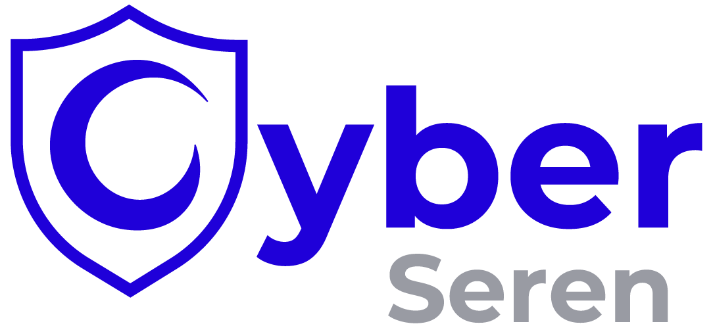

  <a href="https://cyberseren.com">
    <picture>
      <source media="(prefers-color-scheme: dark)" srcset="assets/logo-dark.png">
      
    </picture>
  </a>

<h1 align="center">CyberSeren Skills</h1>

Skills d'agent IA par <a href="https://cyberseren.com">CyberSeren</a>.

## Fonctionnement

CyberSeren publie des skills d'agent IA pour les produits de sécurité que nous mettons en place chez nos clients et pour Serenity, notre dashboard. Chaque éditeur a son plugin, et chaque produit de l'éditeur a son plugin à l'intérieur. Vous installez tout un éditeur, un seul produit ou un seul skill.

Aujourd'hui, CyberSeren est partenaire officiel de Palo Alto Networks. Les premiers skills couvrent donc les produits Palo Alto Networks. Des skills pour Serenity suivront.

## Plugins

- `all` : tous les skills CyberSeren
  - `palo-alto` : tous les skills Palo Alto Networks
    - `prisma-browser` : tous les skills Prisma Browser
      - `prisma-browser-access-data-control-rule` : créer des règles Access & Data Control dans Strata Cloud Manager
  - `serenity` : à venir, skills pour Serenity, le dashboard CyberSeren

## Installation

Installez tout un éditeur, un seul produit ou un seul skill. Choisissez une seule méthode d'installation par agent : avec deux méthodes, chaque skill apparaît deux fois.

### Claude Code

    /plugin marketplace add cyberseren/cyberseren-skills
    /plugin install all@cyberseren                                       # tous les skills CyberSeren
    /plugin install palo-alto@cyberseren                                 # tous les skills Palo Alto Networks
    /plugin install prisma-browser@cyberseren                            # tous les skills Prisma Browser
    /plugin install prisma-browser-access-data-control-rule@cyberseren   # un seul skill

### GitHub Copilot CLI

    copilot plugin marketplace add cyberseren/cyberseren-skills
    copilot plugin install prisma-browser@cyberseren

### Codex

    codex plugin marketplace add cyberseren/cyberseren-skills
    codex plugin add prisma-browser@cyberseren

### Cursor

Installez `prisma-browser` depuis la Cursor Marketplace.

### VS Code

Lancez **Chat: Install Plugin From Source** et collez `https://github.com/cyberseren/cyberseren-skills`.

### Tout agent avec npx

Fonctionne avec OpenCode, Gemini CLI, Goose, Windsurf, Cline et plus de 70 autres agents.

    npx skills add cyberseren/cyberseren-skills
    npx skills add cyberseren/cyberseren-skills --skill prisma-browser-access-data-control-rule

### npm

    npm install -D @cyberseren/skills
    npx skills experimental_sync -y

## Utilisez un modèle local ou interne

Ces skills lisent et modifient votre configuration de sécurité. Utilisez-les avec un modèle hébergé en local ou dans votre entreprise, pour que vos données de production restent dans votre entreprise.

Les skills sont du Markdown simple et fonctionnent avec tout modèle que votre agent sait appeler. Choisissez un modèle qui sait appeler des outils : le skill pilote un navigateur par un serveur MCP. Par exemple :

- Codex avec Ollama ou LM Studio : `codex --oss --local-provider ollama`
- OpenCode avec un fournisseur Ollama ou LM Studio

## Avertissement

Produit non officiel de Palo Alto Networks. Palo Alto Networks, Prisma et Cortex sont des marques de Palo Alto Networks, Inc. Relisez chaque changement avant de le publier.

## Licence

Apache-2.0
