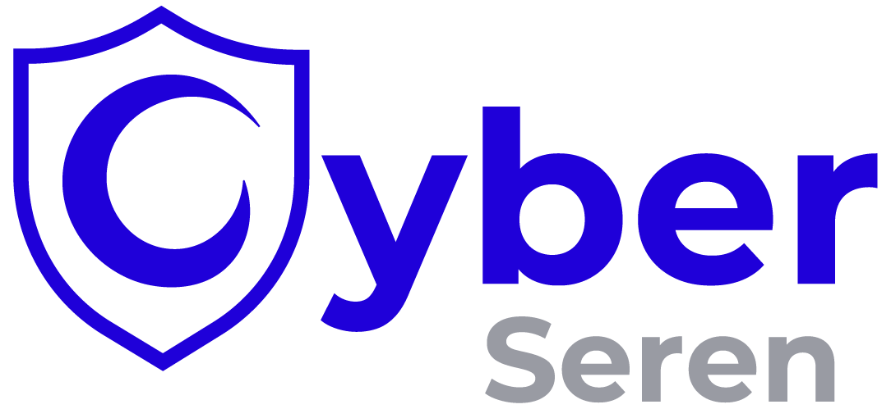

  <a href="https://cyberseren.com">
    <picture>
      <source media="(prefers-color-scheme: dark)" srcset="assets/logo-dark.png">
      
    </picture>
  </a>

<h1 align="center">CyberSeren Skills</h1>

Agent skills by <a href="https://cyberseren.com">CyberSeren</a>.

## How it works

CyberSeren publishes agent skills for the security products we deploy for our customers and for Serenity, our dashboard. Each vendor has its own plugin, and each of its products has a plugin inside it. You install a whole vendor, one product or one skill.

Today, CyberSeren is an official Palo Alto Networks partner, so the first skills cover Palo Alto Networks products. Skills for Serenity are coming next.

## Plugins

**Palo Alto Networks**
- `palo-alto`: all Palo Alto Networks skills below
  - `prisma-browser`: create Access & Data Control rules in Strata Cloud Manager

**CyberSeren**
- `serenity`: coming soon, skills for Serenity, the CyberSeren dashboard

## Install

Install a whole vendor, one product or one skill. Pick one install method per agent: with two methods, every skill shows up twice.

### Claude Code

    /plugin marketplace add cyberseren/cyberseren-skills
    /plugin install palo-alto@cyberseren        # all Palo Alto Networks skills
    /plugin install prisma-browser@cyberseren   # Prisma Browser skills only

### GitHub Copilot CLI

    copilot plugin marketplace add cyberseren/cyberseren-skills
    copilot plugin install prisma-browser@cyberseren

### Codex

    codex plugin marketplace add cyberseren/cyberseren-skills
    codex plugin add prisma-browser@cyberseren

### Cursor

Install `prisma-browser` from the Cursor Marketplace.

### VS Code

Run **Chat: Install Plugin From Source** and paste `https://github.com/cyberseren/cyberseren-skills`.

### Any agent with npx

Works with OpenCode, Gemini CLI, Goose, Windsurf, Cline and 70+ other agents.

    npx skills add cyberseren/cyberseren-skills
    npx skills add cyberseren/cyberseren-skills --skill prisma-browser-access-data-control-rule

### npm

    npm install -D @cyberseren/skills
    npx skills experimental_sync -y

## Use a local or internal model

These skills read and change your security configuration. Run them with a model hosted locally or inside your company, so your production data stays in your company.

The skills are plain Markdown and work with any model your agent can call. Pick a model with tool calling: the skill drives a browser through an MCP server. For example:

- Codex with Ollama or LM Studio: `codex --oss --local-provider ollama`
- OpenCode with an Ollama or LM Studio provider

## Disclaimer

Not an official Palo Alto Networks product. Palo Alto Networks, Prisma and Cortex are trademarks of Palo Alto Networks, Inc. Review every change before you publish it.

## License

Apache-2.0
